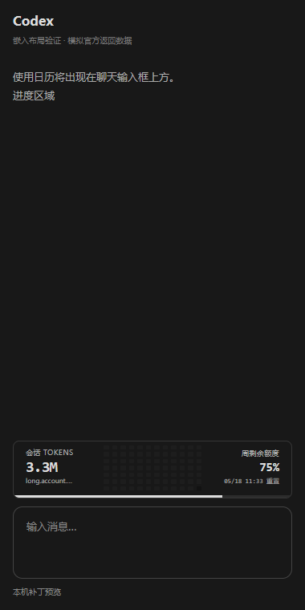

# Codex Pulse

**在 Codex 输入框上方，查看用量、额度与使用足迹。**

[](https://github.com/haochen12/codex-pulse/actions/workflows/test.yml)
[](LICENSE)
[](package.json)

Codex Pulse 是面向 **Codex VS Code 扩展**的轻量本机补丁。它在聊天输入框上方添加一张用量卡片，将会话 token、周剩余额度、重置时间和历史热力图集中展示。

> 本项目不是 OpenAI 官方产品，也不是独立 VSIX 扩展。数据使用官方 Codex App Server 接口；界面嵌入与连接接入依赖扩展内部结构，Codex 升级后可能需要重新应用或适配。

## 预览



*预览使用模拟账号与用量，不包含真实账户数据。*

## 目录

- [功能](#功能)
- [环境要求](#环境要求)
- [快速开始](#快速开始)
- [命令与安装位置](#命令与安装位置)
- [恢复与升级](#恢复与升级)
- [通过 Skill 维护补丁](#通过-skill-维护补丁)
- [数据来源与隐私](#数据来源与隐私)
- [兼容性](#兼容性)
- [常见问题](#常见问题)
- [开发与测试](#开发与测试)
- [参与贡献](#参与贡献)
- [许可证](#许可证)

## 功能

- **会话用量**：接收 Codex 原生统计事件，以 K/M 简写显示，悬停查看完整数值。
- **周剩余额度**：百分比、底部进度条与官方重置时间。
- **账号标识**：显示官方返回的登录邮箱，长邮箱省略，悬停查看完整内容。
- **历史背景**：最近 12 周的每日用量热力格，悬停查看日期与 token 数。
- **主题适配**：沿用 VS Code 的背景、文字、边框和强调色。
- **安装管理**：扩展目录识别、安装状态检查、原文件备份及 SHA-256 恢复校验。

## 环境要求

- Node.js **22 或更高版本**。
- 已安装并登录的 Codex VS Code 扩展。
- 当前用户对目标扩展目录有写入权限。
- 通过 Git 获取源码时需要 Git，也可下载仓库源码 ZIP。

应用补丁无需运行 `npm install`。第三方依赖仅用于开发阶段的界面测试。

## 快速开始

### 1. 获取源码

```sh
git clone https://github.com/haochen12/codex-pulse.git
cd codex-pulse
```

### 2. 检查并应用

```sh
node scripts/patch-codex.cjs status
node scripts/patch-codex.cjs apply
```

Windows、macOS 和 Linux 使用相同命令。`status` 检查当前安装状态与入口结构；`apply` 进行安装前校验、备份和写入。结构不匹配时会停止操作。

### 3. 重新加载 VS Code

打开命令面板，运行 **Developer: Reload Window / 开发人员：重新加载窗口**。卡片会出现在 Codex 输入框上方，收到官方数据后更新。

## 命令与安装位置

| 命令 | 用途 |
| --- | --- |
| `node scripts/patch-codex.cjs status` | 检查安装状态；已安装时校验补丁文件 |
| `node scripts/patch-codex.cjs apply` | 备份原文件并应用补丁 |
| `node scripts/patch-codex.cjs restore` | 校验并恢复原文件 |
| `node scripts/patch-codex.cjs --help` | 查看参数说明 |

默认从 `~/.vscode/extensions` 的注册表选择启用的 Codex 版本。存在多个未注册版本时，需要明确指定目录。

| 参数 | 用途 |
| --- | --- |
| `--editor vscode` | VS Code 稳定版，默认值 |
| `--editor insiders` | VS Code Insiders |
| `--editor server` | VS Code 远程扩展目录 |
| `--editor server-insiders` | VS Code Insiders 远程扩展目录 |
| `--extensions-dir "路径"` | 指定扩展根目录，适用于便携安装或自定义目录 |
| `--target "路径"` | 直接指定某个 Codex 扩展版本的目录 |

例如：

```sh
node scripts/patch-codex.cjs apply --editor insiders
node scripts/patch-codex.cjs apply --extensions-dir "/custom/extensions"
node scripts/patch-codex.cjs apply --target "/custom/extensions/openai.chatgpt-VERSION"
```

路径包含空格时请加引号。WSL、SSH 和容器用户应在 **Codex 实际运行的扩展宿主环境**执行；本地与远程安装分别处理。使用路径参数安装后，检查和恢复时也传入相同参数。

## 恢复与升级

**Codex Pulse 不会关闭 Codex 自动更新或锁定扩展版本**，也不会修改 VS Code 更新设置、扩展注册信息或文件权限。是否自动更新由 VS Code 中 Codex 扩展的自动更新设置决定；可在扩展面板中找到 Codex，通过齿轮菜单检查。

Codex 可以照常升级，无需为了保留卡片而关闭更新。升级可能覆盖补丁，卡片消失时按下方流程重新应用；本工具不会在后台自动修改新版本。

恢复补丁：

```sh
node scripts/patch-codex.cjs restore
```

恢复完成后重新加载 VS Code。请勿同时运行多个补丁命令。

补丁修改 `out/extension.js`、`webview/index.html`，并新增三个资源文件。原文件与校验清单保存在目标扩展目录的 `codex-usage-patch-backup` 中。恢复前会检查补丁和备份文件，遇到外部修改时停止，避免覆盖其他更新。

- **更新 Codex Pulse**：先用原工具恢复，再更新源码并重新应用。
- **更新 Codex**：升级可能覆盖补丁或产生新的扩展目录。升级后先运行 `status`，确认结构匹配再运行 `apply`。
- **完全移除**：先恢复并重新加载 VS Code，再删除项目目录。不要提前删除仍需用于恢复的备份。

Codex 升级后执行：

```sh
node scripts/patch-codex.cjs status
node scripts/patch-codex.cjs apply
```

仅在 `status` 显示未安装且结构匹配时运行 `apply`，然后重新加载窗口。如果显示已安装且校验通过，无需重新应用；结构不匹配时等待补丁适配。不要将旧版本的备份恢复到新版本目录。

## 通过 Skill 维护补丁

仓库提供 [`codex-pulse-update`](skills/codex-pulse-update/SKILL.md) 技能，用于检查状态、更新源码，以及在 Codex 升级后重新应用兼容的补丁。

将 `skills/codex-pulse-update` 文件夹复制到 `$CODEX_HOME/skills/`，未设置 `CODEX_HOME` 时使用 `~/.codex/skills/`。让 Codex 重新加载技能后，在对话中输入：

```text
$codex-pulse-update 更新 Codex Pulse 补丁
```

仅检查时输入 `$codex-pulse-update 检查补丁状态`。技能不会关闭 Codex 自动更新；遇到不兼容版本会报告需要适配。它在被调用时执行维护，不会后台自动运行，也不会替你升级 Codex 扩展。

## 数据来源与隐私

| 内容 | 官方接口或事件 | 更新方式 |
| --- | --- | --- |
| 每日历史 | `account/usage/read` | 每分钟请求；日期沿用官方返回 |
| 当前会话 token | `thread/tokenUsage/updated` | 收到原生事件时更新 |
| 账户额度 | `account/rateLimits/read`、`account/rateLimits/updated` | 定期读取及原生事件更新 |
| 登录账号 | `account/read` | 定期读取，账号变更时重新请求 |

协议参考：[Codex App Server 官方文档](https://learn.chatgpt.com/docs/app-server)。

数据请求通过现有 Codex 连接发送。补丁不解析会话 JSONL、不读取登录凭据，也没有独立的遥测或数据上传服务。邮箱和统计数据会显示在界面中，分享截图前请自行检查。

统计口径：

- 当前会话统计尚未到达时，卡片显示官方今日汇总，并标注“今日 TOKENS”。
- token 是用量统计，不能直接换算为账单金额；K/M 显示有四舍五入。
- 周额度由官方返回的 10080 分钟窗口识别，进度条表示**剩余**百分比。没有该窗口时显示等待。
- 重置时间默认使用系统时区；已有 `codexUsage.timeZone` 配置时沿用。每日汇总日期不重新换算时区。
- 热力颜色按可见 12 周内的单日峰值分档，表示相对用量。

## 兼容性

已验证的 Codex 扩展版本：**26.1111.21308**。

| 平台 | 验证情况 |
| --- | --- |
| Windows | 已完成本机补丁应用、恢复及 Chromium 界面验证 |
| macOS | 已检查目录逻辑与可移植性，尚未完成实机验证 |
| Linux | 已检查目录逻辑与可移植性，尚未完成实机验证 |

仓库配置了三平台单元测试和 Linux 浏览器测试，执行结果见 [GitHub Actions](https://github.com/haochen12/codex-pulse/actions)。CI 不等同于真实 Codex 扩展中的实机验证。

跨平台工具不代表兼容所有 Codex 版本。扩展内部结构或官方接口可用性变化时，仍可能需要适配。

## 常见问题

**为什么显示“待更新”或读取失败？**

官方接口可能尚未返回统计、额度窗口已经到期，或当前登录方式不支持相关能力。API key 账户不保证有账户级用量数据。补丁不会回退到本地日志估算。

**为什么不是逐 token 跳动？**

会话数字随 Codex 上报统计事件更新，频率由 Codex 决定；历史汇总每分钟刷新。

**提示结构不匹配怎么办？**

当前扩展版本可能需要适配。请提交 Issue 并附版本信息，不要手动绕过结构检查。

**恢复时提示文件被修改怎么办？**

目标文件可能被扩展升级或其他补丁改动。保留备份与错误信息，先确认改动来源，不要用旧文件直接覆盖新版扩展。

## 开发与测试

单元测试无需安装依赖：

```sh
npm test
```

安装开发依赖并运行界面测试：

```sh
npm ci
npx playwright install chromium
npm run test:ui
```

界面测试使用模拟官方返回，不读取真实账户记录。可通过环境变量 `CHROME_PATH` 指定现有浏览器的可执行文件路径。

打包运行文件：

```sh
npm pack
```

生成的压缩包只包含运行脚本、嵌入资源、README 和许可证。本项目没有发布到 npm；从仓库源码或自行生成的包运行。

```text
embedded/   卡片界面与官方接口桥接
scripts/    路径识别、补丁管理和界面验证
test/      单元测试
docs/      模拟数据预览
```

## 参与贡献

欢迎通过 [Issues](https://github.com/haochen12/codex-pulse/issues) 报告问题，或提交 Pull Request。

报告兼容问题时，请提供操作系统、VS Code 版本、Codex 扩展版本、复现步骤和错误信息。请移除邮箱、登录凭据、真实聊天记录及个人用量。

提交代码前运行 `npm test`；修改界面时同时运行 `npm run test:ui`。版本适配请说明验证过的 Codex 版本，以及安装和恢复结果。

## 许可证

本项目采用 [MIT License](LICENSE)。Copyright © 2026 haochen12。
